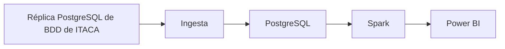

# Proyecto 2 · Analítica académica ITACA (origen relacional)

## Descripción y objetivo

El mismo dashboard de análisis académico en Power BI que el Proyecto 1, pero partiendo de una fuente de datos relacional en lugar de documental — practicar el pipeline completo con el otro paradigma de origen de datos habitual en proyectos reales.

## Arquitectura

*Diagrama del pipeline completo. Empieza con uno provisional en el Bloque 0 y actualízalo al terminar cada bloque.*

