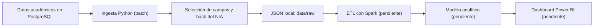

# Proyecto 2 · Analítica académica ITACA (origen relacional)

> Proyecto del módulo Big Data aplicado. Dashboard de análisis académico en Power BI a partir de datos de ITACA almacenados en PostgreSQL, con una arquitectura batch.

## Descripción y objetivo

Construir el mismo dashboard de análisis académico que en el Proyecto 1, pero partiendo de una fuente relacional en lugar de exportaciones XML. El objetivo es practicar la extracción desde PostgreSQL, la preparación de los datos con Spark y su posterior visualización en Power BI.

El flujo debe ser reproducible y evitar la publicación de credenciales o información identificativa del alumnado.

**Estado actual:** PostgreSQL 17 configurado con Docker Compose y script de ingesta batch implementado, con selección de campos, seudonimización del identificador del alumnado y exportación a JSON. Las transformaciones con Spark y el dashboard están pendientes. La documentación detallada y las evidencias de la práctica de ingesta se incorporarán posteriormente.

## Arquitectura



*Arquitectura objetivo. Actualmente está implementada la extracción desde PostgreSQL hasta los JSON locales. El diagrama se actualizará al completar cada bloque.*

## Fuentes de datos

| Fuente | URL / origen | Formato | Frecuencia de actualización | Licencia / condiciones de uso | Última ingesta |
| --- | --- | --- | --- | --- | --- |
| Datos académicos de ITACA para la práctica | Base PostgreSQL local con las tablas `alumnos`, `contenidos`, `calificaciones` y `cursos`, correspondientes a varios cursos académicos | Tablas relacionales; exportación local a JSON | Manual, según la actualización del conjunto de datos | Uso docente autorizado; no publicar datos personales ni credenciales | Consultar la fecha de los JSON locales de `data/raw/` |

El origen relacional y las relaciones entre tablas se conservarán durante el procesamiento. Los archivos de datos deben permanecer fuera de Git, incluso cuando se haya aplicado un hash a los identificadores: la seudonimización no garantiza por sí sola el anonimato completo.

## Estructura del repositorio

| Carpeta / archivo | Contenido y estado |
| --- | --- |
| `etl/ingesta_itaca_bd.py` | Script actual de conexión, extracción, triaje de campos, hash del NIA y guardado en JSON |
| `etl/` | Código de ingesta actual y ubicación prevista para las futuras transformaciones |
| `dashboard/` | Carpeta local vacía, reservada para el informe de Power BI |
| `data/raw/` | JSON generados por la ingesta; excluidos de Git |
| `data/staged/` | Carpeta local vacía, reservada para datos intermedios |
| `data/curated/` | Carpeta local vacía, reservada para datos preparados para análisis |
| `docker-compose.yml` | Servicio PostgreSQL 17, volumen persistente y comprobación de disponibilidad |
| `.env` | Configuración y credenciales locales; excluido de Git |
| `.gitignore` | Reglas para credenciales, datos, entornos Python, cachés y archivos generados |
| `.venv/` | Entorno Python local; todavía contiene archivos versionados que deben dejar de seguirse |
| `README.md` | Descripción, despliegue y seguimiento del proyecto |

**Nota:** Git no conserva carpetas vacías. `dashboard/`, `data/staged/` y `data/curated/` no aparecerán en un clon mientras no tengan contenido versionado o un `.gitkeep`. Todavía no existen `.env.example` ni un archivo de dependencias.

## Cómo desplegar el entorno

### Requisitos

- Docker Engine o Docker Desktop en ejecución y Docker Compose v2.
- Python 3.10 o superior, con `venv` y `pip` disponibles.
- Puerto local elegido para PostgreSQL disponible; normalmente `5432`.
- Ejecutar los comandos desde la raíz de este proyecto.

### Configuración local

Crear o revisar `.env` con las siguientes variables. Estos valores son ejemplos, no credenciales reales; no sobrescribir una configuración existente sin comprobarla:

```dotenv
POSTGRES_HOST=127.0.0.1
POSTGRES_PORT=5432
POSTGRES_DB=itaca_academico
POSTGRES_USER=usuario_local
POSTGRES_PASSWORD=sustituye_por_una_clave_local
```

Docker Compose utiliza esta configuración para inicializar PostgreSQL. El script lee las mismas variables para conectarse desde el equipo local.

**Importante:** si el volumen ya contiene una base de datos, cambiar las variables de `.env` no cambia automáticamente sus usuarios, contraseñas ni bases existentes. No eliminar el volumen para resolver un problema de conexión sin antes proteger los datos.

### Arrancar PostgreSQL

```bash
docker compose up -d postgres
docker compose ps
```

El contenedor se llama `postgres_db`, utiliza `postgres:17` y conserva sus datos en el volumen `postgres_data`. El puerto se publica únicamente en `127.0.0.1`. Esperar a que el servicio aparezca como `healthy`.

Para consultar los registros o detener el servicio sin eliminar el volumen:

```bash
docker compose logs --tail=50 postgres
docker compose down
```

El archivo Compose arranca el servidor, pero **no importa automáticamente los datos de ITACA**. Antes de ejecutar la ingesta, las cuatro tablas de origen deben existir y estar cargadas en el esquema `public`.

### Preparar Python y ejecutar la ingesta

En Linux o macOS, crear el entorno virtual si no existe, activarlo e instalar las dependencias:

```bash
python3 -m venv .venv
source .venv/bin/activate
python -m pip install psycopg2-binary python-dotenv
python etl/ingesta_itaca_bd.py
```

La ingesta genera un archivo `data/raw/<tabla>_AAAA-MM-DD.json` por tabla. Una ejecución correcta termina con `Ingesta completada correctamente` y código de salida `0`; los errores controlados devuelven `1`.

Una nueva ejecución el mismo día sustituye el JSON de cada tabla únicamente cuando su escritura ha terminado correctamente. La fecha del nombre es la fecha de ejecución; el campo `anyo` identifica el curso académico de los registros.

**Seguridad:** la sesión de ingesta se configura como solo lectura, pero también debe utilizarse un usuario con permisos limitados a `SELECT`. No publicar `.env`, JSON de alumnado ni capturas con información sensible.

## Bitácora de prácticas

### Bloque 0 · Entorno

- **Objetivo:** preparar un repositorio independiente y un PostgreSQL local para trabajar con datos académicos relacionales.
- **Pasos realizados:** creación del repositorio, README, `docker-compose.yml`, configuración local mediante `.env` y reglas de exclusión en `.gitignore`.
- **Problemas encontrados y solución:** las dependencias Python deben instalarse en el entorno virtual seleccionado; el conector se instala como `psycopg2-binary` y se importa como `psycopg2`.
- **Resultado:** configuración de PostgreSQL y entorno de ejecución disponibles. Sigue pendiente retirar del seguimiento de Git los archivos de `.venv` ya versionados.

### Bloque 1 · Ingesta batch relacional

- **Objetivo:** extraer las cuatro tablas del modelo académico y generar JSON locales con los campos solicitados y el identificador del alumnado seudonimizado.
- **Pasos realizados:** script de ingesta implementado con triaje por tabla, hash consistente, validación de configuración, registro de errores y escritura mediante archivos temporales.
- **Problemas encontrados y solución:** se han corregido las variables de conexión y la lista de tablas; la revisión detallada de calidad y relaciones se documentará en la entrega de la práctica.
- **Resultado:** exportación local a JSON disponible. **Pendiente completar esta sección con la explicación específica del ejercicio, las validaciones y las capturas solicitadas.**

### Siguientes bloques · ETL y visualización

- **Objetivo:** preparar los datos con Spark y construir el dashboard académico en Power BI.
- **Pasos realizados:** pendientes de implementación.
- **Problemas encontrados y solución:** pendientes de registrar.
- **Resultado:** modelo analítico, indicadores y visualizaciones pendientes de desarrollo y validación.

## Decisiones técnicas

| Decisión | Alternativa considerada | Motivo |
| --- | --- | --- |
| PostgreSQL 17 en Docker | Instalación nativa | Facilita reproducir el entorno y conservar los datos en un volumen independiente |
| Python y `psycopg2` para la primera extracción | Conexión JDBC desde Spark desde el inicio | Permite validar la fuente relacional antes de incorporar el procesamiento distribuido |
| JSON en la zona `raw` | CSV como salida final de la práctica | Coincide con el formato solicitado para esta ingesta |
| Triaje de campos y hash consistente del NIA | Exportar todas las columnas sin filtrar | Reduce la información personal exportada y conserva la relación entre alumnos y calificaciones |
| Escritura temporal antes de sustituir el JSON | Escribir directamente sobre el archivo final | Evita dejar una salida incompleta si falla la escritura |
| Spark y Power BI como etapas previstas | Procesamiento e informes en un único script | Separa la preparación de los datos de su análisis visual |

## Incidencias resueltas

| Incidencia | Solución / estado |
| --- | --- |
| El README no tenía la misma estructura que el resto de proyectos | Se añaden fuentes, estructura del repositorio, despliegue, bitácora, decisiones e incidencias |
| Faltaba el conector de PostgreSQL en el entorno Python | Se documenta la instalación de `psycopg2-binary` en el entorno virtual |
| La lista inicial incluía `modulos`, que no existe como tabla independiente | El script consulta `alumnos`, `contenidos`, `calificaciones` y `cursos` |
| Los errores podían interrumpir la ingesta sin cerrar la conexión | Se incorporan registro de excepciones y cierre de conexión mediante `finally` |

**Pendientes:** completar la documentación y evidencias del ejercicio, revisar las incidencias de integridad entre tablas, configurar un usuario de lectura, añadir `.env.example` y dependencias, y retirar `.venv` del seguimiento de Git sin borrar el entorno local. Estos puntos no se dan por resueltos al actualizar este README.
